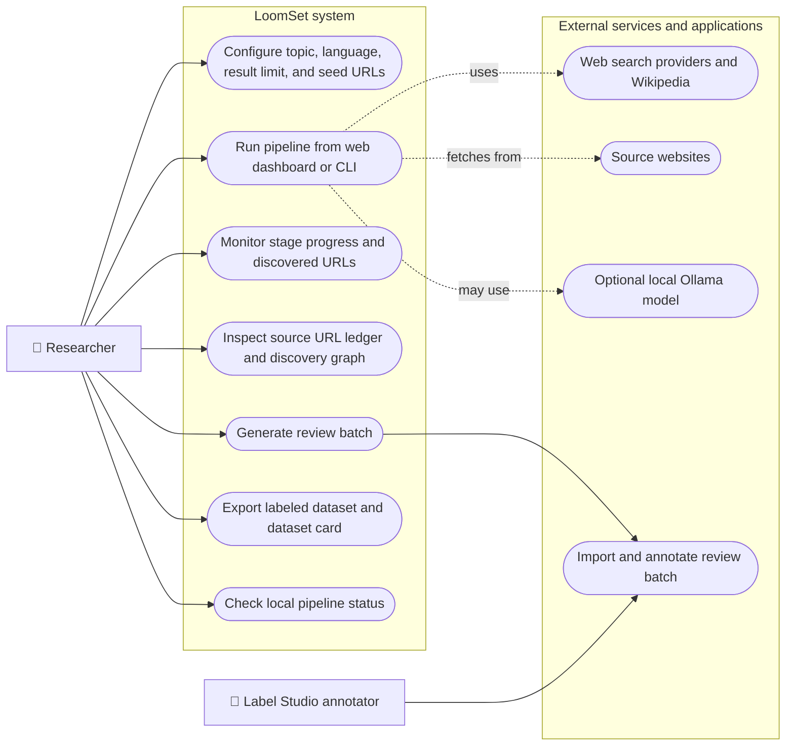
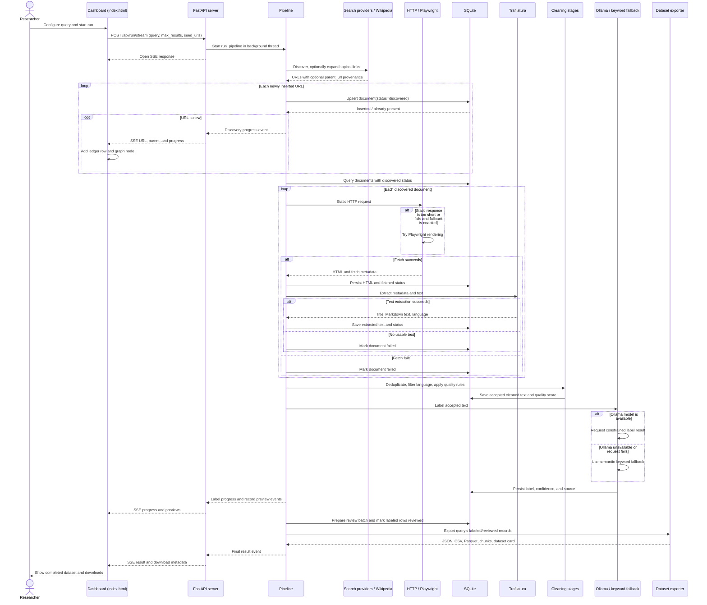
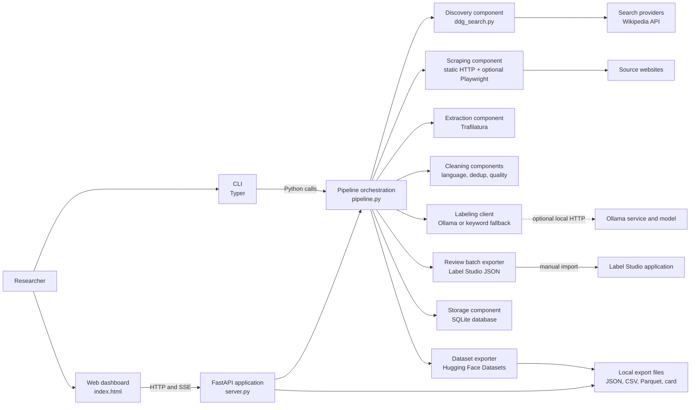

# LoomSet

LoomSet is a local, resumable pipeline for building text datasets on niche topics. It discovers real web pages, downloads and extracts their text, cleans and deduplicates records, assigns relevance labels, and exports the resulting text with source metadata. The local web interface streams progress from the same pipeline used by the CLI.

## What it does

- Searches across independent web search providers and uses Wikipedia article search as a full-text fallback. Provider failures are isolated so one unavailable backend does not stop discovery.
- Downloads discovered pages, with a Playwright Chromium fallback for pages that need JavaScript.
- Extracts and cleans text. Pages with no usable extracted text are excluded from the dataset.
- Labels each record `relevant` or `irrelevant` with Ollama when available, or with LoomSet's keyword fallback.
- Shows labeling progress and record previews in the web interface. The ledger includes clickable source URLs.
- Exports actual extracted text and provenance in JSON Lines, CSV, and Parquet formats.

Search coverage depends on external providers and the query. For focused topics, add specific seed URLs in the web interface when you already know useful authoritative sources. A seed URL is processed as a source page; it does not trigger a crawl of every link on that page.


## System design: UML views

The diagrams below describe the implemented LoomSet v2 system. Mermaid renders them in GitHub's Markdown viewer. Mermaid has native sequence and class diagram syntax; the activity, use-case, and component views use Mermaid flowcharts with UML conventions (initial/final nodes, decisions, actors/use cases, system boundary, and component boundaries).

### a. Activity diagram — a topic to exported dataset

This activity view follows `run_pipeline`: discovery and persistence happen first, followed by status-driven fetching, extraction, cleaning, labeling, review-batch generation, and export. Failure to fetch or extract a page affects that document; it does not abort the run. When a clean result set is unavailable, later stages naturally have no documents to process.

```mermaid
flowchart TD
    start((Start)) --> input[Researcher enters query, result limit, optional seed URLs]
    input --> request[Run through dashboard or CLI]
    request --> discover{Seed URLs supplied?}
    discover -- Yes --> seeds[Validate seed URLs as direct sources]
    discover -- No --> search[Search independent web backends]
    search --> enough{Enough usable URLs?}
    enough -- No --> wiki[Try Wikipedia full-text search]
    wiki --> topical{Still below limit and has results?}
    topical -- Yes --> expand[Fetch topical same-domain links from top results]
    topical -- No --> normalize[Normalize and deduplicate URLs]
    expand --> normalize
    enough -- Yes --> normalize
    seeds --> normalize
    normalize --> persist[Upsert newly discovered URLs in SQLite]
    persist --> event[Emit per-URL discovery event to dashboard]
    event --> docs{More discovered documents to fetch?}
    docs -- Yes --> fetch[Fetch next page over HTTP]
    docs -- No --> batch[Continue with extracted documents]
    fetch --> static{Static response usable?}
    static -- No, fallback enabled --> dynamic[Try Playwright dynamic fetch]
    dynamic --> fetchok{Page fetched?}
    static -- Yes --> fetched[Persist fetched HTML and status]
    static -- No, fallback disabled --> failed[Mark this document failed]
    fetchok -- Yes --> fetched
    fetchok -- No --> failed
    fetched --> fetchmore{More discovered documents?}
    failed --> fetchmore
    fetchmore -- Yes --> fetch
    fetchmore -- No --> batch
    batch --> extract[Extract title, metadata, and Markdown text]
    extract --> textok{Usable text extracted?}
    textok -- No --> extractfail[Mark document failed]
    textok -- Yes --> dedup[Remove exact and near duplicates]
    dedup --> language[Apply configured language filter]
    language --> quality[Normalize text and apply length/quality filters]
    quality --> accepted{Document passes cleaning?}
    accepted -- No --> filtered[Exclude document from downstream stages]
    accepted -- Yes --> label[Label with Ollama or keyword fallback]
    label --> review[Write Label Studio-compatible review batch]
    review --> export[Export document and passage datasets plus card]
    filtered --> finish(((Complete)))
    extractfail --> finish
    export --> finish
```



**Why it matters:** the flow makes the transformation and rejection points visible. Researchers can distinguish discovery coverage, fetch/extraction failures, and records removed during cleaning instead of treating the final dataset as an opaque download.

### b. Use case diagram — researcher and external tools

The researcher can run LoomSet through either interface, inspect discovery and progress, and retrieve the resulting files. Label Studio is an external tool: LoomSet creates an import-compatible batch, while the researcher performs annotation in Label Studio. The current pipeline does not automatically import reviewed annotations back from Label Studio.



**Why it matters:** it separates the researcher-facing workflow from external dependencies. This is useful for study planning: search availability, source access, optional model inference, and human annotation are distinct dependencies with distinct roles.

### c. Sequence diagram — streamed browser run

The browser submits a validated request to FastAPI. FastAPI runs the shared pipeline in a worker thread and forwards callback events through Server-Sent Events (SSE). The CLI calls the same pipeline directly and omits the browser/SSE participants.



**Why it matters:** the sequence identifies the boundaries where provenance, error handling, persistence, and progress reporting occur. It also shows that “reviewed” in the database currently means the review batch was prepared; the external Label Studio decision cycle is not wired back into the run endpoint.

### d. Class diagram — persisted entities and pipeline services

The database entities are the persisted domain model. `Pipeline` and the stage modules are service classes used here to show responsibility and data flow; they are Python modules/functions rather than literal Python classes. Each `ExtractedText`, `CleanedText`, and `Label` row is keyed by one document ID.

```mermaid
classDiagram
    class Document {
      +UUID id
      +string url
      +string query
      +string domain
      +string fetch_method
      +string raw_html
      +datetime fetched_at
      +string status
      +canonicalize_url()
      +upsert_without_regression()
    }
    class ExtractedText {
      +UUID doc_id
      +string title
      +string text
      +string lang
      +datetime extracted_at
    }
    class CleanedText {
      +UUID doc_id
      +string text
      +string dedup_hash
      +float quality_score
      +datetime cleaned_at
    }
    class Label {
      +UUID doc_id
      +string label
      +string label_source
      +float confidence
      +boolean reviewed
      +datetime labeled_at
    }
    class Pipeline {
      +run_pipeline(query, max_results, seed_urls)
      +emit_progress(event)
    }
    class DiscoveryService {
      +discover_documents(query, max_results)
      +normalize_url(url)
      +dedupe_urls(urls)
    }
    class FetchService {
      +stage_scraping(db_path, query)
      +fetch_static(url)
      +fetch_dynamic(url)
    }
    class ExtractionService {
      +extract_documents(documents)
    }
    class CleaningService {
      +deduplicate_documents(documents)
      +filter_language(documents)
      +quality_filter(documents)
    }
    class LabelingService {
      +auto_label_text(text, query, labels)
      +keyword_fallback(text, query, labels)
    }
    class ReviewExportService {
      +stage_review(db_path, output_path)
      +export_review_batch(records, path)
    }
    class DatasetExportService {
      +assign_stratified_splits(records)
      +create_passage_chunks(records)
      +export_dataset(records, export_dir)
    }
    class SQLiteStore {
      +ensure_db(path)
      +fetch_documents(status, query)
      +upsert_document(record)
      +update_status(doc_id, status)
    }

    Document "1" *-- "0..1" ExtractedText : extracted into
    Document "1" *-- "0..1" CleanedText : cleaned into
    Document "1" *-- "0..1" Label : labeled as
    Pipeline --> DiscoveryService : discovers
    Pipeline --> FetchService : fetches
    Pipeline --> ExtractionService : extracts
    Pipeline --> CleaningService : cleans
    Pipeline --> LabelingService : labels
    Pipeline --> ReviewExportService : prepares review batch
    Pipeline --> DatasetExportService : exports
    DiscoveryService --> SQLiteStore : upserts URLs
    FetchService --> SQLiteStore : persists fetch state
    ExtractionService --> SQLiteStore : persists extracted text
    CleaningService --> SQLiteStore : persists accepted text
    LabelingService --> SQLiteStore : persists labels
    ReviewExportService --> SQLiteStore : reads and updates review state
    DatasetExportService --> SQLiteStore : reads export records
```



**Why it matters:** one-to-zero-or-one stage records make the document lineage explicit. A researcher can relate an exported row back to its source URL and the pipeline’s stored extraction, cleaning, and label results.

### e. Component diagram — deployable and external boundaries

LoomSet is currently a local modular monolith: one FastAPI application and one Python pipeline, with SQLite as local state. The CLI invokes the same pipeline without going through HTTP. Ollama, search providers, source websites, and Label Studio are separate external systems or applications.



**Why it matters:** component boundaries show which parts can be replaced or studied independently without implying a distributed architecture LoomSet does not have. This supports reproducibility and future experimentation while keeping the current system practical to run on one machine.

## Why LoomSet is useful to researchers

The project literature review identifies a practical research bottleneck: for a niche or emerging topic, a researcher may need to discover sources, scrape pages, clean text, assign labels, and shape a training dataset, while the tools for those tasks are commonly developed separately. LoomSet connects those steps in one local workflow and records source URLs, query, language, fetch time, label source, confidence, and quality metadata alongside text.

The review's conclusion describes LoomSet's contribution as **architectural composition**, not a new scraping, cleaning, or labeling algorithm. It combines established open-source approaches into a usable pipeline. That framing is useful because it lets researchers adapt a repeatable baseline to a topic, inspect each stage, and focus effort on domain-specific source selection, label definitions, and validation. The literature review surveyed 22 included papers across scraping, cleaning, and labeling and maps reported limitations to design choices in the project. [LoomSet literature review](Research/Literature%20Paper%20for%20LoomSet.pdf) · [LoomSet literature survey](Research/Literature%20Survey%20LoomSet.pdf)

Several examples in that review motivate the design: CCNet focuses on filtering large generic web crawls rather than discovering niche-topic pages; data-programming and weak-supervision work reduces manual labeling but requires domain expertise or labeling functions; semi-automated labeling work keeps a human involved. LoomSet addresses the end-to-end workflow problem by combining targeted discovery, text processing, local/fallback labeling, a review-batch export, and dataset packaging. These are motivations, not evidence that LoomSet outperforms those systems. [CCNet](https://doi.org/10.48550/arXiv.1911.00359) · [Data Programming](https://doi.org/10.48550/arXiv.1605.07723) · [Snorkel](https://doi.org/10.14778/3157794.3157797) · [Semi-Automated Data Labeling](https://doi.org/10.48550/arXiv.2012.14702)

The project is useful as a **research starting point** for building small, topic-focused corpora and testing pipeline choices with standard outputs. It is not a guarantee of label accuracy, source rights, complete coverage, or policy compliance. The current pipeline does not automatically detect/redact PII, enforce robots.txt or site terms, or import human-edited Label Studio results. Researchers should review source policies, license terms, privacy implications, and labels before sharing or training on exports. See [Research/Limitations.md](Research/Limitations.md) for known constraints.

## UML scope and interpretation

These are system-level UML views, not a claim that every depicted service is an object-oriented class in the Python code. The class diagram uses conceptual service classes to make responsibilities readable; persisted entities and their one-to-one relationships correspond to the SQLite schema. The diagrams describe current behavior, including the external/manual review boundary. The future scaling architecture in research proposal documents is not presented here as already implemented.

## Requirements

- Python 3.11 or newer
- Internet access for discovery and page downloads
- Optional: [Ollama](https://ollama.com) for model-based labeling
- Optional: Playwright Chromium for JavaScript-heavy pages
- Optional: Label Studio to use the generated human-review batch

## Quick start — step by step

Follow these steps in order to clone, install, and verify the project.

### 1. Clone the repository

```bash
git clone <repo-url> LoomSet
cd LoomSet
```

### 2. Create and activate a virtual environment

**Windows PowerShell**

```powershell
py -3.11 -m venv .venv
.\.venv\Scripts\Activate.ps1
```

**Linux / macOS**

```bash
python3.11 -m venv .venv
source .venv/bin/activate
```

> [!TIP]
> Any Python ≥ 3.11 works (including 3.12, 3.13, 3.14). Use whichever version you have installed — substitute `py -3.14` or `python3.12` as appropriate.

### 3. Install the package in editable mode

```bash
python -m pip install --upgrade pip
python -m pip install -e .
```

This installs all required dependencies (FastAPI, uvicorn, trafilatura, pandas, pyarrow, duckduckgo-search, etc.) and registers the `loomset` CLI command.

### 4. Run the test suite

```bash
pytest -q
```

All tests use local fixtures and run **offline** — no internet, Ollama server, or Playwright browser is needed. A passing run confirms the installation is correct.

### 5. Start the web interface

```bash
loomset serve --host 127.0.0.1 --port 8000
```

Or equivalently:

```bash
python -m uvicorn loomset.server:app --host 127.0.0.1 --port 8000
```

Open [http://localhost:8000](http://localhost:8000) in your browser.

> [!TIP]
> **Unified Local LLM**: LoomSet now includes an automated process supervisor. If [Ollama](https://ollama.com) is installed on your machine, LoomSet auto-starts the `ollama serve` background daemon automatically and auto-detects your best installed model—no need to manually start a separate terminal window! If Ollama is not installed, LoomSet runs its built-in semantic keyword scoring engine automatically.

### 6. Run a pipeline from the CLI (alternative to the web UI)

```bash
loomset run --query "solar-punk urban planning" --max-results 10
```

Pipeline state is stored in `data/loomset.db`; exports go to `data/exports/<query-slug>/`.

## Exported ML-grade records

LoomSet generates full-fidelity, training-ready datasets in RFC 4180 multiline CSV, JSON, and Apache Parquet formats:

- **Document-level dataset** (`dataset.csv`, `dataset.json`, `dataset.parquet`):
  Each record contains:
  - `id` (UUID), `text` (clean semantic Markdown), `title`
  - `label` (string) and categorical `label_id` (numeric integer)
  - `confidence` (float 0.0–1.0) and heuristic `quality_score` (0.0–1.0)
  - `split`: stratified 80% `train`, 10% `validation`, and 10% `test` partition
  - `word_count`, `char_count`, and `token_estimate`
  - Source provenance: `url`, `domain`, `language`, `fetched_at`, `label_source`, and `query`
- **Passage/Chunk-level dataset** (`dataset_chunks.csv`, `dataset_chunks.json`, `dataset_chunks.parquet`):
  Documents are automatically broken into sliding-window passages (350 words by default with a 40-word overlap) formatted for standard Transformer context windows (BERT, RoBERTa, DeBERTa), RAG vector databases, and embedding fine-tuning.
- **Hugging Face Dataset Card** (`README.md`):
  Includes YAML frontmatter, a label-to-ID/count table, split distributions, token totals, field descriptions, and Python loading examples.

## Resuming and data

SQLite is the source of truth. LoomSet canonicalizes and deduplicates URLs, reuses existing document state, and avoids downloading completed URLs again. Search failures produce no results rather than fabricated placeholder URLs. The `seed_documents` argument in `run_pipeline` is a fixture hook for tests; it is not part of normal CLI or web discovery.

## Tests and architecture notes

Run the test suite with:

```bash
pytest -q
```

Tests use local fixtures and do not require live search or a running Ollama service by default. See [WORKING.md](WORKING.md) for the architecture and file-by-file guide.
