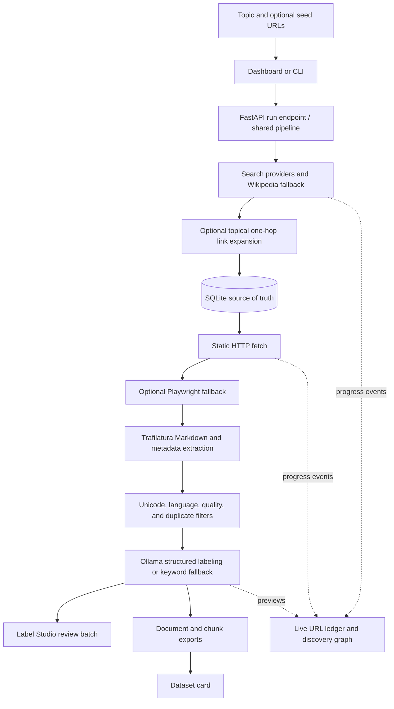

# How LoomSet v2 Works

This document explains the current LoomSet implementation: how a topic becomes a locally stored, reviewed, ML-ready text dataset. It follows an architecture-first format, describing the problems addressed by the v2 upgrades, the live pipeline, and the modules that implement it.

---

## 1. Executive Summary & What Changed in v2

LoomSet is local software for building text datasets from real web pages. It is not itself a dataset. Search results, downloaded HTML, extracted text, labels, and exports are runtime data produced while the software runs.

### A. One pipeline for the CLI and browser

- **Before**: the browser experience and the data processing steps were difficult to follow as one workflow, and progress was limited.
- **Now**: the CLI and web dashboard call the same Python pipeline. The dashboard uses `/api/run/stream` and receives Server-Sent Events for stage changes, counts, URLs, and labeling previews. A SQLite database stores progress so a run can be resumed without treating every page as new.

### B. Real discovery with source relationships

- **Before**: discovery coverage and failure behavior were limited, and placeholder URLs could make an empty search look successful.
- **Now**: LoomSet queries independent web-search backends, isolates provider failures, uses Wikipedia full-text search as a fallback, and can expand a short result set with topical, same-domain links from the top search pages. If a page was found through another page, its discovery event includes that parent URL. Direct search results are roots. The browser shows URLs and graph nodes incrementally as discovery events arrive.
- Search results and page fetching depend on external services and can return no usable pages. LoomSet does not fabricate example URLs. User-supplied seed URLs are fetched as pages; they do not start an unrestricted crawl.

### C. Higher-fidelity text and stricter cleaning

- **Before**: extracted text could lose useful structure, and exact duplicates were the main duplicate check.
- **Now**: Trafilatura first extracts semantic Markdown and page metadata, with plain text as a fallback. Cleaning normalizes Unicode, removes residual table noise, filters languages, screens for low-quality or boilerplate-heavy text, and removes exact and near duplicates using shingles with an optional RapidFuzz comparison.

### D. Local labeling and dataset exports

- **Now**: Ollama can label records with a structured response when a model is available. If it is unavailable, LoomSet uses its built-in semantic keyword scorer and records that confidence and label source in the output. Exports include document-level and passage-level files, reproducible label-stratified splits, label IDs, and text metrics.

---

## 2. Architecture & Pipeline Flow

The dashboard graph reflects discovery provenance: direct search results have no incoming edge, while a topical page found from another page is connected to that referrer. These relationships are part of the live discovery events; they are not a stored graph table in SQLite.

---

## 3. Stage-by-Stage Operation

1. **Choose a topic**: The dashboard collects the niche, desired result count, and language. The CLI accepts a query and result limit.
2. **Discover URLs**: Search backends are queried independently. Wikipedia is used when web search has not filled the requested result count. If the result set is still short, LoomSet requests topical same-domain links from up to three seed pages. URLs are normalized and deduplicated. User-provided seed URLs skip search and enter as independent source URLs.
3. **Persist and report discoveries**: Newly inserted pages are stored with `discovered` status. The pipeline emits one progress event per newly inserted URL. In the dashboard, those events add rows to the URL ledger and nodes to the graph as they arrive.
4. **Fetch pages**: New `discovered` documents are fetched over HTTP. Short or unsuccessful static responses can use the dynamic fetcher when configured. Failed fetches are marked `failed` and do not stop the run.
5. **Extract text**: Trafilatura extracts page title, article text, and available metadata. Markdown output is preferred; plain text is the fallback. Empty or unusable extraction is marked failed.
6. **Clean and deduplicate**: Exact and near-duplicate text is removed, language rules are applied, and quality filters reject very short or low-quality content. Accepted text and quality information are saved.
7. **Label records**: LoomSet uses Ollama when available and falls back to semantic keyword scoring when it cannot use a model. The default label set is `relevant` and `irrelevant`. Label events update progress and show previews in the dashboard.
8. **Prepare review and export**: A Label Studio-compatible batch can be generated. The export stage writes document and chunk datasets plus a dataset card under the query-specific export directory.

---

## 4. Storage, Resuming & Data Boundaries

SQLite is the pipeline's operational source of truth. The default database is `data/loomset.db` (the configured path can override it). It stores document URLs and status, downloaded HTML, extracted text, cleaned text, and labels. It is runtime state and can grow with crawled data; it is not required to install or run the software from source.

URL identity is canonicalized for deduplication: scheme and host are lowercased, default ports and fragments are removed, and trailing path slashes are normalized. A unique URL is stored once. Stages select documents by status, so completed pages are not fetched again as newly discovered pages. Existing records are not overwritten simply because a later search finds the same URL.

Generated exports are also runtime data. The default location is `data/exports/`, with query-specific files in a slug-named subdirectory. The software source, configuration, documentation, and tests are distinct from the database and generated datasets. Check repository tracking and ignore rules before committing runtime data; ignoring a file does not remove a copy already recorded in Git history.

---

## 5. Dataset Outputs

For each query, LoomSet can produce:

### Document-level files

- `dataset.json`: document records in JSON format.
- `dataset.csv`: fully quoted CSV that preserves embedded newlines in text.
- `dataset.parquet`: columnar document records.

Records include text, title, label, numeric `label_id`, confidence, a deterministic train/validation/test split, word/character/token estimates, quality score, and source provenance such as URL, domain, language, fetch time, label source, and query.

### Passage-level files

- `dataset_chunks.json`
- `dataset_chunks.csv`
- `dataset_chunks.parquet`

Long text is split into overlapping passages (350 words by default with a 40-word overlap). Each passage retains its document ID, index, label, split, and source URL. Short documents produce one passage. Passage splits follow their parent document split.

### Dataset card

`README.md` in the export directory contains YAML metadata, dataset counts, label and split summaries, field descriptions, source domains, and Python loading examples. The current card declares a CC-BY license; verify that license is appropriate for the sources and intended use before distributing an export.

---

## 6. Main Implementation Areas

- `src/loomset/discovery/ddg_search.py`: independent search backends, Wikipedia fallback, topical link expansion, URL normalization, deduplication, and discovery provenance.
- `src/loomset/scraping/static_spider.py`: static page downloads and generic fetch helpers.
- `src/loomset/scraping/dynamic_fetch.py`: optional Playwright rendering and fetch status handling.
- `src/loomset/extraction/trafilatura_extract.py`: page metadata and semantic Markdown extraction, with plain text fallback.
- `src/loomset/cleaning/dedup.py`: exact hashing and near-duplicate detection.
- `src/loomset/cleaning/language_filter.py` and `quality_filter.py`: language selection, normalization, text quality checks, and quality scores.
- `src/loomset/labeling/ollama_client.py`: Ollama client, structured label parsing, and keyword fallback.
- `src/loomset/labeling/ollama_manager.py`: local Ollama process and model availability helpers.
- `src/loomset/storage/db.py`: SQLite schema, URL-aware upsert, stage queries, and status persistence.
- `src/loomset/pipeline.py`: stage orchestration, resumable behavior, and progress events.
- `src/loomset/server.py`: FastAPI routes, static dashboard, SSE pipeline execution, dataset APIs, and Ollama status/control endpoints.
- `src/loomset/export/hf_export.py`: label mappings, stratified splits, CSV/JSON/Parquet output, passage generation, and dataset card generation.
- `index.html`: local multi-stage dashboard, streaming progress, URL ledger, discovery graph, and dataset controls.

---

## 7. Running LoomSet

Install the package in a Python 3.11+ environment with `python -m pip install -e .`. Start the browser UI with `loomset serve --host 127.0.0.1 --port 8000`, then open `http://localhost:8000`. Start a CLI run with `loomset run --query "your topic" --max-results 10`. Optional seed URLs can be supplied in the dashboard.

Ollama and Playwright are integrations rather than requirements for the core pipeline. Discovery and fetching require network access. Search results, extraction success, labels, and final dataset size depend on the query, source websites, and local configuration.

See `README.md` for installation and command examples, `WORKING.md` for the repository guide, and `v2upgrade.md` for the upgrade rationale and implementation plan.
