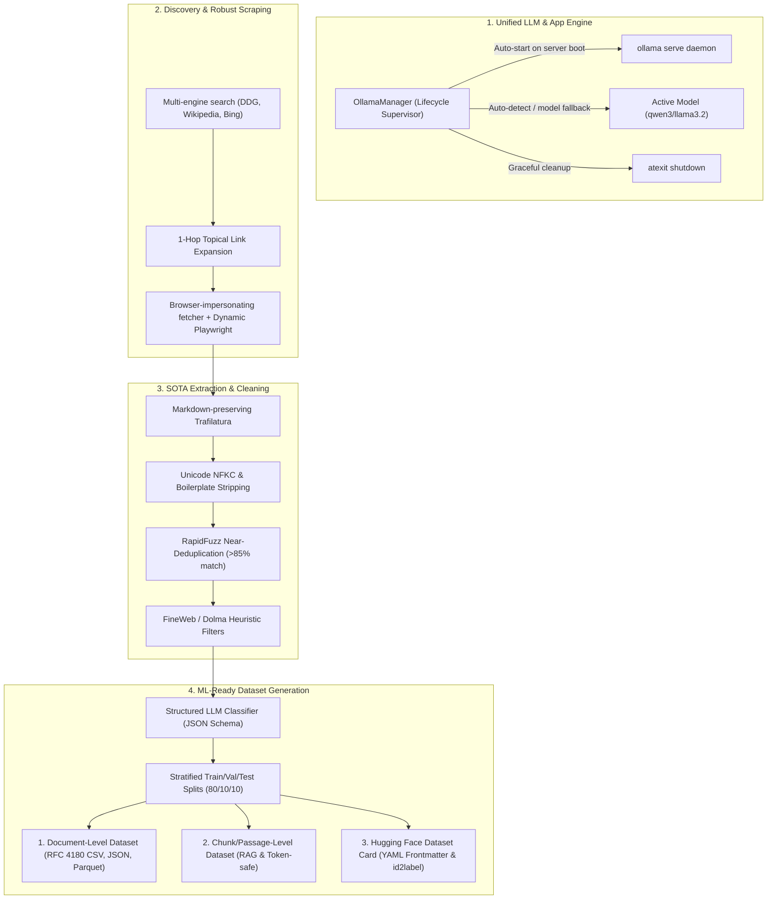

# LoomSet v2 Upgrade & Implementation Plan

This document outlines the architecture, research findings, and step-by-step implementation plan for upgrading LoomSet into an enterprise-grade, ML-ready dataset pipeline with unified local LLM lifecycle management.

---

## 1. Executive Summary & Root Cause Analysis

### A. The LLM / App Separation Problem
- **Problem**: Previously, LoomSet operated completely detached from Ollama. If the user had not manually opened a separate terminal and executed `ollama serve`, LoomSet would silently fall back to a primitive 3-line keyword string matcher (`_keyword_fallback`) that generated arbitrary confidence values.
- **Solution**: An **`OllamaManager`** process supervisor that detects installed Ollama binaries (e.g. `C:\Users\HP\AppData\Local\Programs\Ollama\ollama.exe`), automatically spawns and manages `ollama serve` in the background with health polling, handles model negotiation, and cleanly hooks into the FastAPI application lifespan and CLI startup. The web dashboard will display live LLM daemon status and model selector controls.

### B. The Unusable CSV / Dataset Problem
- **Problem**: 
  1. `_flat(text)` in `hf_export.py` forcefully replaced all newlines with spaces (`re.sub(r"\s+", " ", text)`), destroying markdown hierarchy, paragraphs, lists, and code blocks.
  2. No `split` column (train/val/test). Standard ML models cannot be trained or evaluated without reproducible splits.
  3. No categorical `label_id` (numeric integers 0, 1, ...) or `label2id` / `id2label` mappings needed by PyTorch, Hugging Face `transformers`, and Scikit-learn.
  4. Monolithic full-page records overflow typical Transformer context windows (512 or 1024 tokens for BERT, RoBERTa, DeBERTa), truncating 80%+ of long articles.
  5. Missing data quality metrics (`word_count`, `char_count`, `token_estimate`, `quality_score`).
- **Solution**:
  1. **Strict RFC 4180 Multiline CSV**: Preserve full-fidelity markdown text in safely quoted CSV rows.
  2. **Stratified Splits**: Deterministic 80% train / 10% validation / 10% test splits stratified by class label.
  3. **Dual Export Views**:
     - **Document-Level**: Full-text articles with provenance metadata.
     - **Chunk-Level**: Sliding-window passages (250–500 words with 10% overlap) with `chunk_id`, `doc_id`, `chunk_index`, and `token_estimate`, directly consumable for RAG, embedding finetuning, and sequence classification.
  4. **Rich Hugging Face Dataset Card**: Comprehensive `README.md` with YAML metadata (`task_categories: text-classification`, class balance charts, license, schema).

### C. Extraction, Cleaning & Discovery Shortcomings
- **Problem**: Flat unformatted text extraction, exact-only SHA-256 deduplication (missing near-duplicates and syndicated articles), lack of LLM-grade heuristic filtering (Dolma/FineWeb standards), and single-page search limits.
- **Solution**:
  1. **Markdown-Preserving Extraction**: Trafilatura with semantic markdown formatting (`#`, `##`, `*`, `>`).
  2. **Near-Duplicate Deduplication**: `RapidFuzz` token-set ratio / MinHash deduplication to drop near-duplicate pages (>85% similarity).
  3. **FineWeb / Dolma Heuristic Filters**: Stopword ratio checks, word-length bounds (3–10 chars), repetition filtering, and boilerplate phrase removal.
  4. **1-Hop Topical Link Expansion**: Crawl top in-domain links matching query keywords to ensure rich datasets even for niche queries.

---

## 2. Architecture & Pipeline Flow

---

## 3. Implementation Steps

1. **Phase 1: Unified Local LLM Lifecycle**
   - Create `src/loomset/labeling/ollama_manager.py` with automatic process discovery, background daemon launch, readiness health polling, and clean process termination.
   - Integrate into `src/loomset/server.py` (FastAPI lifespan) and `src/loomset/labeling/ollama_client.py`.
   - Add status and model management endpoints in `server.py` and UI status badge in `index.html`.

2. **Phase 2: ML-Ready Dataset Structuring & Export**
   - Overhaul `src/loomset/export/hf_export.py`:
     - RFC 4180 multiline CSV export with quote escaping.
     - Stratified 80/10/10 train/validation/test splits.
     - Categorical `label_id` integer assignment and label maps.
     - Chunk-level sliding window dataset generation (`dataset_chunks.csv`, `dataset_chunks.json`, `dataset_chunks.parquet`).
     - Standard document-level exports (`dataset.csv`, `dataset.json`, `dataset.parquet`).
     - Valid Hugging Face Dataset Card generation (`README.md`).

3. **Phase 3: High-Fidelity Extraction & Advanced Cleaning**
   - Update `src/loomset/extraction/trafilatura_extract.py` to preserve markdown formatting and extract rich metadata.
   - Update `src/loomset/cleaning/dedup.py` with `RapidFuzz` near-duplicate detection.
   - Update `src/loomset/cleaning/quality_filter.py` with Dolma/FineWeb heuristic quality filters (stopword ratio, word length, repetition detection, boilerplate removal) and Unicode NFKC normalization.

4. **Phase 4: Discovery Expansion & Robust Scraping**
   - Update `src/loomset/discovery/ddg_search.py` with 1-hop topical link expansion.
   - Update `src/loomset/scraping/static_spider.py` with realistic browser headers and soft 404 / login detection.

5. **Phase 5: Verification & Quality Assurance**
   - Unit tests for `OllamaManager`, `hf_export`, `dedup`, and `quality_filter`.
   - End-to-end test verifying multi-line RFC 4180 CSV, splits, and chunk generation.
   - Full test suite run (`pytest -q`).

